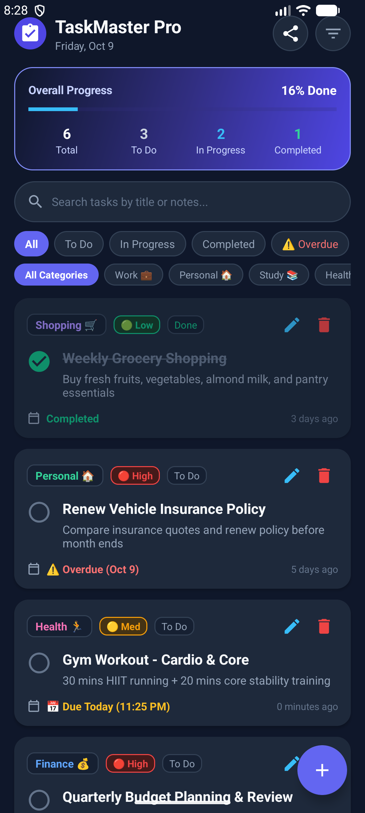

# TaskMaster Pro - Android Task Tracking App

An intuitive, responsive Android task tracker app built with **Kotlin**, **Material Design 3**, and an offline-first **SQLite** architecture.



---

## 🚀 Features

- **📊 Live Metrics & Progress Dashboard**: Dynamic completion percentage bar with 4 status counter chips (Total, To Do, In Progress, Completed).
- **📋 Comprehensive Task Tracking**: Track tasks with statuses (`TODO`, `IN_PROGRESS`, `COMPLETED`), priority tags (`HIGH`, `MEDIUM`, `LOW`), categories, and due dates/times.
- **⏰ Smart Due Date Countdown**: Relative time indicators (*"Today at 5:00 PM"*, *"Tomorrow"*, *"In 3 days"*, *"⚠️ Overdue"*).
- **⚡ One-Tap Completion**: Quick checkbox toggle with instant strikethrough animation and progress update.
- **🔍 Multi-Level Filtering & Search**:
  - Status filters: `All`, `To Do`, `In Progress`, `Completed`, `⚠️ Overdue`.
  - Category filters: `Work`, `Personal`, `Study`, `Health`, `Finance`, `Shopping`.
  - Real-time text search across titles and notes.
- **🔄 Smart Sorting**: Sort tasks by Due Date (Asc/Desc), Priority (High to Low), or Title (A to Z).
- **📤 Export & Share**: Share task list summaries directly via Android's native Share Sheet.

---

## 🛠️ Tech Stack & Architecture

- **Language**: Kotlin
- **Build System**: Gradle Kotlin DSL (`build.gradle.kts`)
- **Android Gradle Plugin**: 9.0.1
- **Target / Compile SDK**: 36.1 (Android 16 preview) | **Min SDK**: 24 (Android 7.0)
- **Architecture**: MVVM-ready with ViewBinding
- **Database**: Local SQLite via `SQLiteOpenHelper`
- **UI Components**: Material 3 Design (`MaterialCardView`, `ChipGroup`, `FloatingActionButton`, `RecyclerView`)

---

## 🗄️ Database Schema

```sql
CREATE TABLE tasks (
    id INTEGER PRIMARY KEY AUTOINCREMENT,
    title TEXT NOT NULL,
    description TEXT,
    category TEXT NOT NULL,
    priority TEXT NOT NULL,
    status TEXT NOT NULL,
    due_date INTEGER NOT NULL,
    created_at INTEGER NOT NULL
);
```

---

## 📦 How to Build & Run

### Prerequisites
- Android Studio Ladybug / Meerkat or Android SDK (API 34+)
- JDK 17 or JDK 21

### Building the APK
```bash
# Clone the repository
git clone <YOUR_REPO_URL>
cd TaskTrackerApp

# Build Debug APK
./gradlew assembleDebug
```

The output APK will be generated at:
`app/build/outputs/apk/debug/app-debug.apk`

---

## 📄 License
This project is open source and available under the [MIT License](LICENSE).
